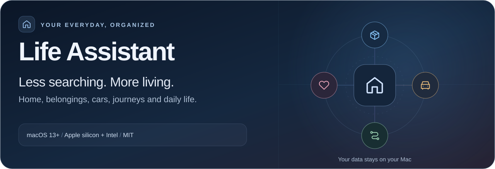
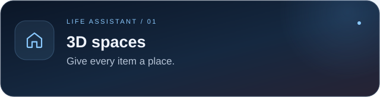
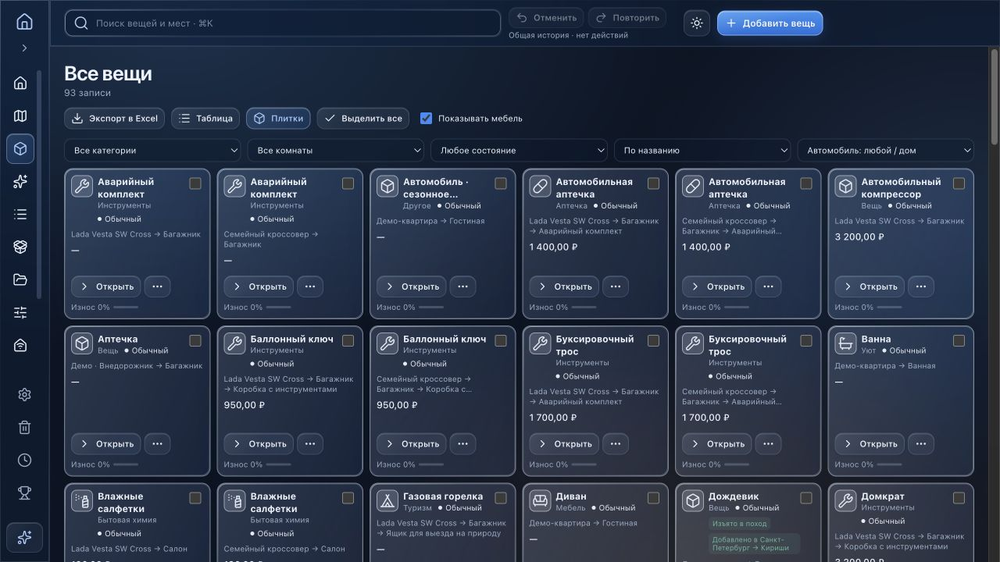
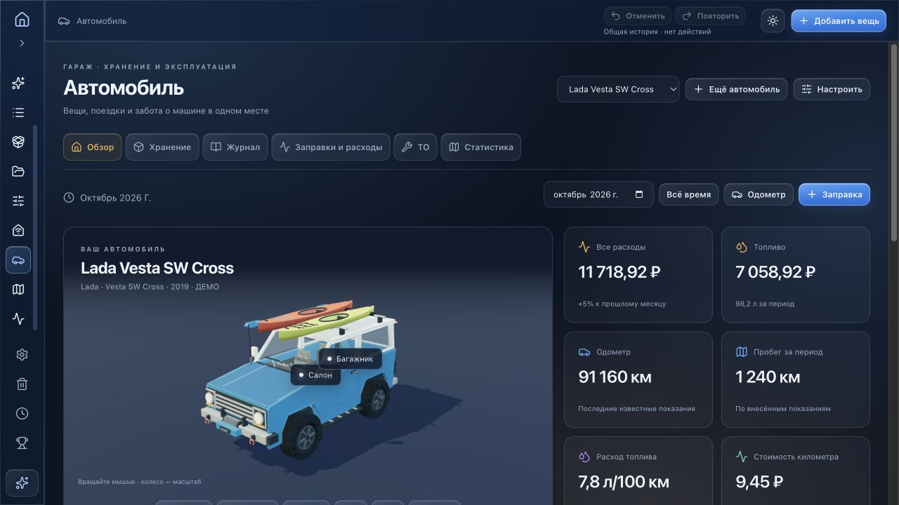
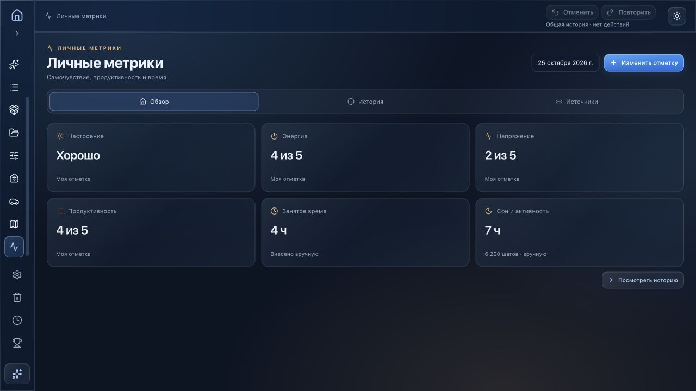

# Life Assistant

**Your home, belongings, car and journeys, brought together.**

   

macOS 13+ · Apple silicon + Intel · Local data · Russian interface

[Русский](README.md) · [Full user guide · Russian](docs/guide.ru.md) · [Report an issue](https://github.com/provalny/my-home/issues)

Life Assistant turns scattered lists into a connected picture of everyday life: where a possession is stored, what a car needs next, which bills are due and what belongs in a travel bag. A 3D home and shared inventory sit alongside home monitoring, vehicle records, travel planning and personal metrics.

There is no required account. Your database stays on your Mac. A first-run introduction offers ten cards followed by a hands-on tour of 34 screens. The examples are fictional and isolated from your personal data.

## Explore the app

Screens below show the running application using fictional demo data. Click a screenshot for its full-size version.

<table>
<tr>
<td width="50%" valign="top">

Arrange rooms and furniture, open storage in 3D and locate items through rooms, shelves and boxes.

</td>
<td width="50%" valign="top">

Photos, prices, condition, wear and rarity. Compact tiles or a table, global search, categories and Excel import/export.

</td>
</tr>
<tr>
<td width="50%" valign="top">

Utility readings, bills, payments, climate, maintenance and period comparisons. Usage and amounts are entered manually.

</td>
<td width="50%" valign="top">

Multiple cars, mileage, fuel, costs, service and tires. Cabin and trunk contents share the main inventory.

</td>
</tr>
<tr>
<td width="50%" valign="top">

Routes, daily plans, 3D bags, packing weights and reusable loadouts. Items retain their original home or car association.

</td>
<td width="50%" valign="top">

A brief daily check-in and a history of well-being, sleep and activity. Manual entry or Apple Health file import.

</td>
</tr>
</table>

Also included: **68 achievements**, an item research assistant, light and dark themes, Liquid Glass, matte and glow surfaces, four palettes, undo/redo, recoverable trash and backups.

## Install

1. Download [**MyHome.dmg**](https://github.com/provalny/my-home/releases/latest/download/MyHome.dmg) from the latest release.
2. Open it, drag **Life Assistant** into **Applications**, then eject the disk image.
3. Launch the app from Applications. Explore the demo or skip it and begin with an empty personal home.

Requires **macOS 13 or later**. One universal build supports **Apple silicon and Intel**.

The current build is ad-hoc signed and has no Apple notarization. If macOS blocks your first launch of the verified download from this repository, follow [Apple’s instructions](https://support.apple.com/102445) to approve it in Privacy & Security.

## Start with five small steps

1. Explore the demo. Replay it under **Settings → Application → Demo mode** (the interface is in Russian).
2. Create your rooms and place furniture in the space editor.
3. Add a few items to shelves or boxes. Use Unplaced for items without a location.
4. Choose category packs for your household, work and hobbies; search with **⌘K**.
5. Choose a daily backup folder under **Settings → Data & backups**.

The [full guide in Russian](docs/guide.ru.md) covers each section, backups, Excel, updates and troubleshooting.

## Phone access

Connect your phone and Mac to the same home Wi-Fi. Enable phone access in the Mac app’s settings and scan its QR code with the phone camera. The phone uses the same database; no phone app is required. The Mac must stay awake and Life Assistant must keep running. Rotating the QR code revokes earlier connections. [Detailed instructions · Russian](docs/phone-access.ru.md).

## Excel and Apple Health

Import `.xlsx` in **Unplaced**: name, category, subcategory, weight in grams and optional price in rubles. Only the name is required. A preview identifies duplicates before adding items. Export includes the shared inventory and archive; it is not a full backup.

Personal metrics can read daily sleep and activity totals from Apple Health’s `export.xml`. This is a manual file import, not continuous HealthKit sync.

## Data and updates

Inventory, photos, journals and achievements live in `~/Library/Application Support/MyHomeInventory/inventory.json`. System preferences are stored in `preferences.json` alongside it. These files are not bundled with releases or published to GitHub.

Download a full JSON backup, or enable daily backups to a chosen folder; the latest **five** are retained. A protective copy is created before restoring a database. Closing the window keeps the app running in the menu bar; **⌘Q** quits fully.

Update from **Settings → Application → Check for updates**, or the Life Assistant menu. Sparkle verifies the update archive’s Ed25519 signature and preserves personal data.

Inventory and manual records work locally. Weather, maps and item research need external services. Item research sends the name, brand and model when you explicitly start a search; found values are reviewed before application. It depends on accessible public pages and may be incomplete or rate-limited. [Details · Russian](docs/item-master.ru.md).

## Development and credits

[Build and test](docs/development.md) · [Release maintenance](docs/releases.md) · [Issues](https://github.com/provalny/my-home/issues)

Based on [House Control](https://github.com/0xProbabillity/house-control), retaining its 3D scene and editor. Thank you to the original author. [Original README](UPSTREAM_README.md) · [MIT license](LICENSE).

Built with [Three.js](https://threejs.org/), [Lucide](https://lucide.dev/), [Sparkle](https://sparkle-project.org/) and [Leaflet](https://leafletjs.com/). Map data: [OpenStreetMap](https://www.openstreetmap.org/copyright). Weather: [Open-Meteo](https://open-meteo.com/). Dependencies retain their respective licenses.
