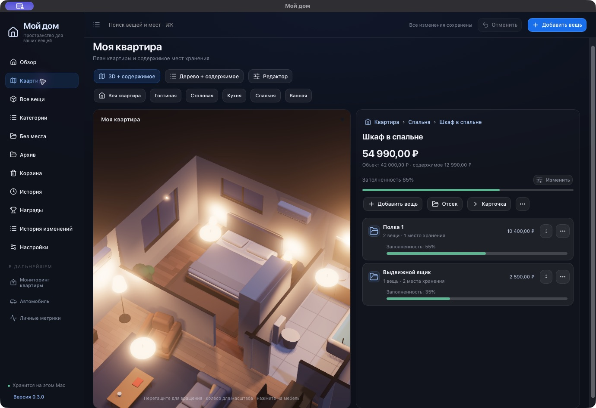
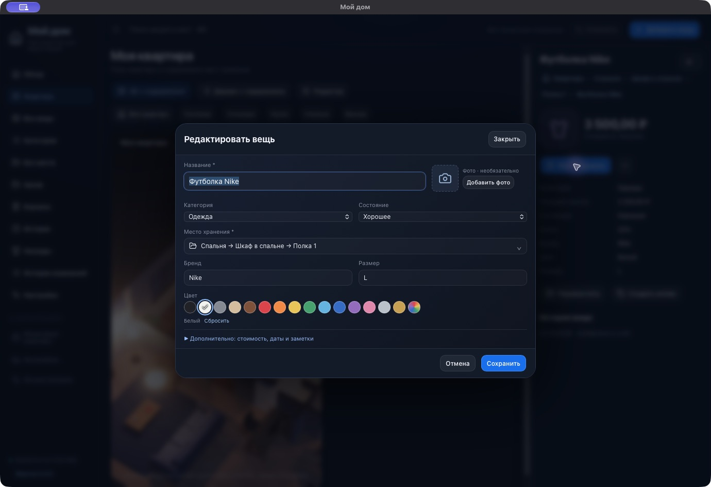
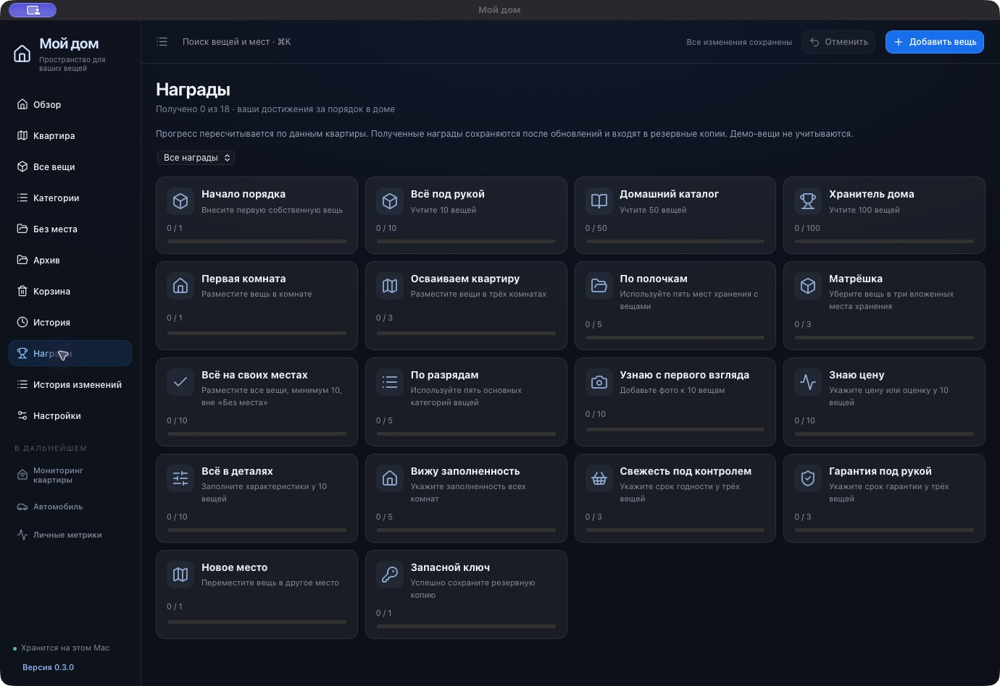

# My Home · Мой дом

### A place for everything.

A local-first macOS inventory with a 3D apartment and nested storage.

[Download for Mac](https://github.com/provalny/my-home/releases/latest) · [Русский](README.md) · [Feedback](https://github.com/provalny/my-home/issues)

Keep track of what you own, where it belongs and what it is worth. Follow an address such as room → wardrobe → shelf → box → item, or search names, categories, attributes, notes and locations. The current application interface is in **Russian**; this README is available in English.

## Install

1. Open the [latest release](https://github.com/provalny/my-home/releases/latest) and download **MyHome-….dmg**.
2. Open the DMG and drag **Мой дом** into **Applications**.
3. Launch the app and explore the sample apartment. Use the setup wizard to start your own home.

Requires **macOS 13 or later**. Universal binary for **Apple silicon and Intel**. Inventory management works offline without an account.

Early builds are **ad-hoc signed, without Apple notarization**. If macOS blocks the initial launch, try opening the downloaded app and use **System Settings → Privacy & Security → Open Anyway**. Only do this for a download you trust from this repository. See [Apple’s instructions](https://support.apple.com/102445). There is no need to disable Gatekeeper globally.

## Update

Choose **Настройки → Проверить обновления…** (Settings → Check for Updates), or use the command in the app menu. Install and relaunch when prompted. Automatic update checks can be toggled in Settings.

Updates replace the **whole application**, including the interface, 3D view and Mac shell. Your apartment, photos, settings and earned achievements stay in place. You do not need to download another installer for ordinary updates.

## Features

| Area | Included |
| --- | --- |
| 3D apartment | Floor-plan editor, furniture placement and a storage tree. |
| Nested inventory | Rooms, furniture, shelves, drawers, boxes and individual items. Move containers with their contents. |
| Fast entry | Separate compact forms for items and storage, one photo, preset attributes, color swatches and saved drafts. |
| Catalog | Table and photo views, filters, editable categories, consistent category icons and global search with **⌘K**. |
| Value and occupancy | Purchase price, current estimate, condition, wear and manual room/storage occupancy. Apartment occupancy averages measured rooms. |
| Archive and trash | Record sales, gifts and disposal; recover deleted items and undo recent changes with **⌘Z**. |
| Reminders | Expiry and warranty dates, overview alerts and optional macOS notifications. |
| Backups | Daily backups to a chosen folder, latest **5 copies**, manual export and a protective copy before restore. |
| Achievements | 18 rewards, recalculated progress and retained earned achievements. |
| Updates | In-app update checks and Sparkle installation with Ed25519 archive verification. |

Item form and achievements

Adding something you already owned does not count as a new purchase. Furniture can be both an item and a storage location; its price is counted once. Missing prices and unknown occupancy remain unknown. Lights and air conditioners are decorative on the main plan. Home monitoring, a vehicle section, personal metrics and a notch island are future features.

## Local data

Inventory, photos, history, trash and achievements live in `~/Library/Application Support/MyHomeInventory/inventory.json`. Preferences are stored alongside it in `preferences.json`. Personal data is not bundled in releases or sent to a project server. Backups include photos and may be stored in a folder of your choice, including iCloud Drive.

The app continues running in the menu bar after its window closes. Quit completely with **⌘Q**. Daily backups run while the app is running and catch up after sleep. Updates retain the bundle identifier and data location. A protective copy is created before restoring a backup and before first saving migrated data.

## For developers

[Build and test](docs/development.md) · [Release maintenance](docs/releases.md)

## Credits

Forked from [House Control](https://github.com/0xProbabillity/house-control), retaining its 3D scene, editor and visual style. Thanks to the original author. [Original README](UPSTREAM_README.md) · [MIT license](LICENSE).

Updates: [Sparkle](https://sparkle-project.org/), BSD. 3D: [Three.js](https://threejs.org/), MIT. Icons: [Lucide](https://lucide.dev/), ISC.
