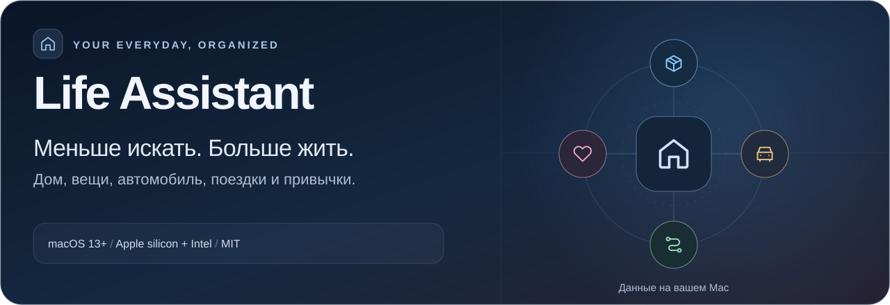
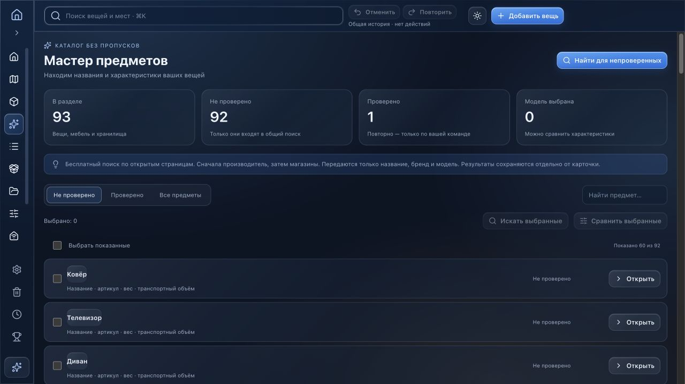
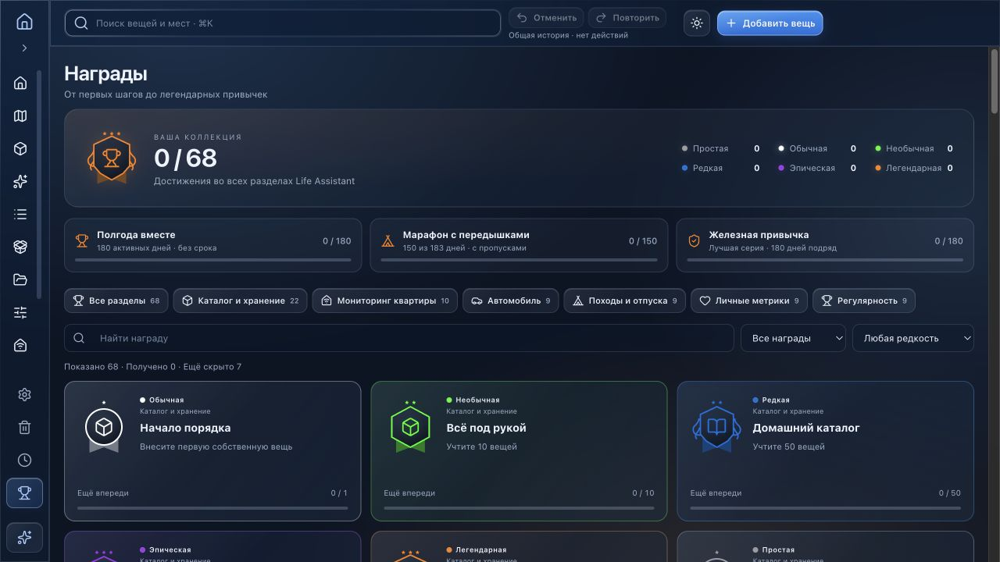

# Life Assistant

**Дом, вещи, автомобиль и поездки — в одной понятной системе.**

 

    

[Обзор](#обзор-приложения) · [Установка](#установка-за-три-шага) · [Первые шаги](#первые-пять-минут) · [Телефон](docs/phone-access.ru.md) · [English](README.en.md)

**Life Assistant** помогает держать под рукой то, что обычно разбросано по заметкам и таблицам: где лежит вещь, когда обслуживать машину, какие счета оплатить и что взять в поездку. В центре — ваш дом в 3D и общий каталог. Рядом — мониторинг квартиры, автомобиль, походы и личные метрики.

Приложение работает локально на Mac, без обязательной регистрации. Первое знакомство — десять коротких карточек и живое демо: можно открыть шкафы, изучить автомобиль и посмотреть заполненные разделы. Примеры отделены от личной базы и исчезают при завершении демо.

## Обзор приложения

Все изображения ниже сняты в работающем приложении на вымышленных демонстрационных данных. Нажмите на экран, чтобы рассмотреть его крупнее.

<table>
<tr>
<td width="50%" valign="top">

Комнаты, мебель, полки и коробки образуют адрес вещи. Открывайте шкафы в 3D, меняйте план и переключайтесь на дерево хранения.

</td>
<td width="50%" valign="top">

Компактные плитки или таблица, фото, цены, износ и редкость. Поиск по всей базе, категории, подборки и обмен с Excel.

</td>
</tr>
<tr>
<td width="50%" valign="top">

Коммунальные услуги, показания, счета, оплаты, климат и домашние работы. История и сравнение периодов; расход и суммы вводятся вручную.

</td>
<td width="50%" valign="top">

Несколько машин, пробег, заправки, расходы, обслуживание и шины. Вещи в салоне и багажнике связаны с общим каталогом.

</td>
</tr>
<tr>
<td width="50%" valign="top">

Маршрут и план по дням, рюкзаки и сумки в 3D, вес и заполнение. Сохраняйте наборы вещей для следующей поездки.

</td>
<td width="50%" valign="top">

Короткая ежедневная отметка настроения, энергии и продуктивности. История сна и активности с ручным вводом или импортом Apple Health.

</td>
</tr>
</table>

### Ещё несколько приятных деталей

- **Мастер предметов** ищет название, артикул, вес и транспортный объём по открытым страницам. Перед применением вы сравниваете значения и выбираете нужные поля. [Как работает поиск](docs/item-master.ru.md).
- **68 наград** за порядок, учёт и привычки: шесть цветов редкости, скрытые достижения и полугодовые цели.
- **Оформление под вас:** светлая и тёмная темы, Liquid Glass, матовые поверхности, свечение и четыре палитры.
- **Сохранность данных:** корзина, общая отмена и повтор, полная JSON-копия и ежедневные резервные копии.

<b>Посмотреть мастер предметов и коллекцию наград</b>

## Установка за три шага

1. **Скачайте [MyHome.dmg](https://github.com/provalny/my-home/releases/latest/download/MyHome.dmg)** из последнего выпуска.
2. **Откройте DMG и перенесите Life Assistant в «Программы».** Затем извлеките образ диска.
3. **Запустите Life Assistant из «Программ».** Пройдите знакомство или пропустите его и начните со своей пустой квартиры.

Нужна **macOS 13 или новее**. Один установщик поддерживает **Apple silicon и Intel**.

<b>Если macOS не даёт открыть приложение</b>

Текущий выпуск подписан локально, без Developer ID и нотарификации Apple. Если источник проверен и вы скачали приложение из этого репозитория, после попытки запуска откройте **«Системные настройки → Конфиденциальность и безопасность»** и используйте доступную кнопку **«Всё равно открыть»**, затем подтвердите открытие. Название кнопки зависит от версии macOS. [Официальная инструкция Apple](https://support.apple.com/ru-ru/102445).

## Первые пять минут

1. **Посмотрите живое демо.** 34 экрана познакомят с квартирой, автомобилем и остальными разделами. Повтор: **Настройки → Приложение → Демо-режим**.
2. **Подготовьте своё пространство.** Откройте редактор, задайте комнаты и расставьте мебель. Для другой квартиры или гаража добавьте ещё пространство.
3. **Добавьте первые вещи.** Выберите полку или коробку и нажмите «Добавить вещь». Быстро занести список можно через **«Без места → Импорт из Excel»**.
4. **Настройте категории под себя.** Выберите готовые наборы для быта, работы и увлечений. Нужную вещь ищите через **⌘K**.
5. **Включите копии.** В **«Настройки → Данные и копии»** выберите отдельную папку для ежедневных резервных копий.

**[Полная инструкция: от первого запуска до восстановления данных →](docs/guide.ru.md)**

## На телефоне — та же база

Mac и телефон должны быть в одной домашней сети Wi-Fi. Откройте **«Настройки → Доступ с телефона → Подключить телефон»** и отсканируйте QR-код. Ничего устанавливать на телефон не нужно; Mac должен оставаться включённым, а приложение — работать.

[Подключение, смена QR-кода и устранение проблем](docs/phone-access.ru.md).

## Обновления и ваши данные

Для обновления выберите **«Настройки → Приложение → Проверить обновления…»** или одноимённую команду меню Life Assistant. Обновляется всё приложение; личная база сохраняется. Архив обновления проверяется по подписи Ed25519.

Данные находятся в `~/Library/Application Support/MyHomeInventory/`: `inventory.json` — общая база, `preferences.json` — системные настройки. Они не входят в GitHub и установщик. После закрытия окна приложение остаётся в строке меню; полный выход — **⌘Q**.

Для каталога и ручных записей интернет не обязателен. Погода, карты и поиск характеристик обращаются к внешним сервисам; поиск предметов передаёт название, бренд и модель. Доступ телефона идёт напрямую к Mac по локальной сети. Подробности: [данные и подключения](docs/guide.ru.md#данные-и-подключения).

## Разработка и обратная связь

[Предложить улучшение или сообщить об ошибке](https://github.com/provalny/my-home/issues) · [Сборка и проверки](docs/development.md) · [Выпуски](docs/releases.md) · [English](README.en.md)

В сообщении об ошибке укажите версию приложения, macOS и действия перед ошибкой. Личную базу, QR-коды и экспорт здоровья публиковать не нужно.

## Благодарности и лицензия

Основано на [House Control](https://github.com/0xProbabillity/house-control): сохранены 3D-сцена и редактор, вокруг которых развивается Life Assistant. Спасибо автору оригинального проекта. [Исходное описание](UPSTREAM_README.md) · [MIT](LICENSE).

[Three.js](https://threejs.org/) · [Lucide](https://lucide.dev/) · [Sparkle](https://sparkle-project.org/) · [Leaflet](https://leafletjs.com/). Карты — [OpenStreetMap](https://www.openstreetmap.org/copyright), погода — [Open-Meteo](https://open-meteo.com/). Лицензии зависимостей сохраняются за их авторами.
