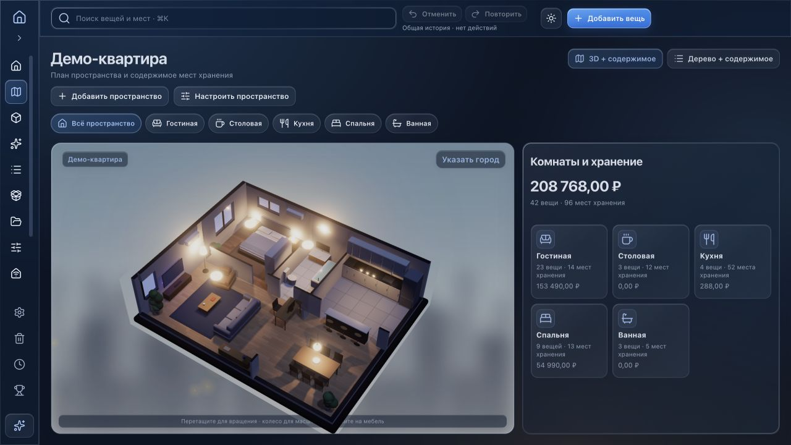

# Life Assistant · руководство пользователя

[← Обзор приложения](../README.md) · [Скачать для Mac](https://github.com/provalny/my-home/releases/latest/download/MyHome.dmg) · [Телефон по Wi-Fi](phone-access.ru.md)

От первого запуска до привычной работы. Инструкция соответствует выпуску **0.4.70**.

## Содержание

[Установка](#установка) · [Знакомство и демо](#знакомство-и-демо) · [Пространство и вещи](#пространство-и-вещи) · [Excel](#импорт-и-экспорт-excel) · [Мониторинг](#мониторинг-квартиры) · [Автомобиль](#автомобиль) · [Поездки](#походы-и-отпуска) · [Метрики](#личные-метрики) · [Копии](#резервные-копии-и-восстановление) · [Обновления](#обновления) · [Помощь](#если-что-то-не-получилось)

## Установка

Требуется macOS 13 или новее. Универсальный установщик подходит для Mac с процессором Apple silicon или Intel.

1. Откройте [последний выпуск](https://github.com/provalny/my-home/releases/latest) и скачайте **MyHome.dmg**.
2. Дважды нажмите на файл DMG.
3. Перетащите **Life Assistant** на значок **Applications / «Программы»**.
4. Извлеките образ диска в Finder и запустите приложение из «Программ».

Выпуск имеет локальную подпись, без нотарификации Apple. Если проверенный файл из этого репозитория блокируется при первом запуске, после попытки открытия зайдите в **«Системные настройки → Конфиденциальность и безопасность»** и подтвердите запуск доступной кнопкой «Всё равно открыть». [Инструкция Apple](https://support.apple.com/ru-ru/102445). Если Mac управляется организацией, доступность такого подтверждения зависит от её правил.

## Знакомство и демо

При первом запуске появляются **10 вводных карточек**. Их можно листать, пропустить или выбрать нужную. После знакомства доступно **живое демо с 34 экранами**: квартира, вещи, автомобиль, мониторинг, поездка и метрики заполнены вымышленными примерами.

В демонстрации можно вращать квартиру и машину, открывать хранилища и пробовать разделы. **«Завершить демо»** закрывает просмотр и удаляет его временные изменения. Личная база хранится отдельно: демо не добавляет в неё вещи и не очищает существующие записи.

Повторный просмотр: **Настройки → Приложение → Демо-режим**. Можно снова включить карточки или сразу открыть демо-квартиру и разделы. Новый пользователь начинает со своей пустой квартиры.

## Пространство и вещи

### Подготовьте план

1. Откройте **«Редактор пространства»**.
2. Задайте комнаты и их размеры, при необходимости измените контур.
3. Расставьте мебель, кухню, технику и места хранения.
4. Сохраните план и вернитесь в **«Пространство»**.

В 3D перетаскивайте сцену для вращения, используйте колесо или жест прокрутки для приближения. Выберите мебель, чтобы посмотреть её хранилища. Вид **«Дерево + содержимое»** удобен, если важнее адреса и список вещей.

Можно добавить несколько пространств, например квартиру и гараж. Каталог, категории и «Без места» общие; «Общая сводка» собирает информацию по всем пространствам.

### Добавьте и найдите вещь

Выберите комнату, шкаф, полку или коробку и нажмите **«Добавить вещь»**. Укажите название и место. Фото, цена, состояние, вес, гарантия и остальные доступные поля заполняются по мере необходимости. Пока место неизвестно, используйте **«Без места»**.

Пример адреса: **Квартира → Спальня → Шкаф → Полка 2 → Коробка**. При перемещении хранилища адреса его содержимого обновляются вместе с ним.

- **«Все вещи»** — компактная таблица или плитки с фильтрами и сортировкой.
- **⌘K** — общий поиск. Название, категория, характеристики и адрес помогают найти вещь.
- **«Категории»** — редактирование названий, значков и иерархии, готовые наборы и подборки по занятиям.
- **Редкость** определяется по названию и известным моделям; ручной выбор в карточке имеет приоритет. Цвет не является оценкой цены.
- **«Мастер предметов»** — поиск официального названия, артикула, веса и транспортного объёма. Сначала выберите результат и сравните поля, затем примените выбранное. [Подробная инструкция](item-master.ru.md).

Мебель может быть одновременно вещью и местом хранения: её стоимость в общей сумме учитывается один раз. Встроенные полки и ящики — места хранения без собственной цены. Неизвестные цены остаются неизвестными.

### Архив, корзина и отмена

Архив используйте для продажи, дарения или списания с сохранением истории. Удалённые вещи попадают в корзину, откуда их можно восстановить. При удалении хранилища внимательно выберите, что делать с содержимым: оставить вещи или удалить вместе с ним.

**⌘Z** отменяет последнее доступное действие; **⇧⌘Z** повторяет его. Общая история объединяет изменения каталога и редактора. Это средство исправления недавних действий; для хранения базы на будущее настройте резервные копии.

## Импорт и экспорт Excel

### Быстро занести список

Откройте **«Без места → Импорт из Excel»** и выберите файл **.xlsx**. Используется первый лист. Столбцы идут в таком порядке:

| A | B | C | D | E |
| --- | --- | --- | --- | --- |
| Название | Категория | Подкатегория | Вес, г | Цена, ₽ |
| Термос | Туризм | Посуда | 420 | 1900 |
| Фонарик | | | | |

Обязательно только название. Заголовок необязателен; пустые строки пропускаются. Вес указывается **в граммах**, цена — **в рублях**. Категории используются повторно или создаются автоматически; подкатегория требует родительскую категорию.

Перед добавлением приложение показывает новые вещи, совпадения с каталогом и повторы внутри файла. Совпадения по названию пропускаются по умолчанию. Если это действительно разные одинаковые предметы, включите их добавление явно в предпросмотре.

После подтверждения вещи попадут в общее **«Без места»**. Распределите их позже. Ошибка строки не приводит к частичному добавлению; успешный импорт целиком отменяется одним действием.

### Выгрузить перечень

**Настройки → Данные и копии → Все вещи в Excel** сохраняет общую базу и архив, включая цены, адреса и характеристики. Фильтры на экране не ограничивают экспорт. Excel удобен для просмотра и обработки списка; для восстановления всей базы используйте **полную JSON-копию**.

## Мониторинг квартиры

В самостоятельном разделе **«Мониторинг квартиры»** добавьте квартиру и её услуги. План для просмотра можно взять из инвентаризации; записи мониторинга ведутся отдельно.

| Вкладка | Что делать |
| --- | --- |
| Обзор | Смотреть услуги, климат, сроки и итоги месяца. |
| Показания | Вносить показания счётчиков и расход. |
| Счета и оплата | Записывать начисления, частичные и полные оплаты. |
| Аналитика | Сравнивать месяцы и периоды на графиках. |
| Обслуживание | Планировать домашние работы и контрольные даты. |
| Настройки мониторинга | Указать услуги, поставщиков, тарифы и параметры квартиры. |

**Показания, расход и денежные суммы вводятся вручную.** Приложение не получает счета от поставщиков и не рассчитывает начисление по тарифу автоматически. Системные напоминания включаются отдельно в настройках Mac-приложения.

## Автомобиль

Добавьте машину в разделе **«Автомобиль»** и заполните её параметры. Для нескольких машин используются отдельные журналы.

- **Обзор** показывает пробег, расходы и основные итоги.
- **Хранение** связывает вещи в салоне, багажнике и коробках с общим каталогом.
- **Журнал** хранит поездки и записи одометра.
- **Заправки и расходы** — литры, суммы и категории затрат.
- **ТО** — работы, расходники, шины и история обслуживания.
- **Статистика** — графики по внесённым данным.

Расход топлива вводится вручную. Готовая 3D-модель служит общим визуальным представлением автомобиля; внешний вид не воспроизводит конкретную марку и комплектацию.

## Походы и отпуска

1. Создайте поездку: название, даты и участников.
2. Добавьте точки **маршрута** и события **по дням**.
3. В **«Инвентаре»** добавьте сумки, рюкзаки, контейнеры или автомобиль из общей базы.
4. Распределите вещи и проверьте вес и заполнение.
5. Сохраните **лодаут** — набор для повторной сборки в следующую поездку.

Вещь сохраняет исходную связь с домом или машиной. Лодаут использует ссылки на имеющиеся вещи, а не создаёт их копии. Оценочные веса мебели явно помечаются; собственный указанный вес имеет приоритет.

Карта OpenStreetMap и сетевые запросы маршрутов требуют интернета. Доступна загрузка **офлайн-схемы** выбранной области; это упрощённая схема, а не полный набор карт для автономной навигации.

## Личные метрики

Нажмите **«Заполнить за сегодня»**, чтобы отметить настроение, энергию, напряжение, продуктивность и занятое время. История позволяет вернуться к предыдущим дням. Эти значения — ваши личные отметки.

Сон, шаги и активность можно внести вручную либо импортировать:

1. На iPhone откройте **«Здоровье»**, нажмите на профиль и выберите экспорт медданных. [Описание экспорта у Apple](https://www.apple.com/legal/privacy/data/ru/health-app/).
2. Перенесите полученный ZIP на Mac и распакуйте его.
3. В **«Личные метрики → Источники»** выберите **«Импортировать export.xml»**.
4. Укажите файл `export.xml` из распакованного архива.

Сохраняются дневные итоги поддерживаемых показателей за последний год. Постоянного фонового подключения к HealthKit нет; новые данные добавляются новым импортом. Ручные записи имеют приоритет.

## Телефон по Wi-Fi

1. Подключите телефон и Mac к одной домашней сети.
2. На Mac откройте **Настройки → Доступ с телефона → Подключить телефон**.
3. Если macOS спросит, разрешите доступ к локальной сети для этой функции.
4. Отсканируйте QR-код камерой телефона и откройте ссылку в браузере.

Телефон работает с той же базой на Mac. Mac должен оставаться включённым и не спать; Life Assistant должен работать. После полного выхода из приложения подключение останавливается; его нужно включить заново.

QR-код даёт доступ к базе — не публикуйте его. **«Обновить QR-код»** отзывает прежние подключения. [Подробности, ограничения и решение проблем](phone-access.ru.md).

## Резервные копии и восстановление

Откройте **«Настройки → Данные и копии»**.

- **«Скачать копию»** — полная база в JSON с пространствами, вещами, фотографиями и историей.
- **«Выбрать папку»** — ежедневные автоматические копии. Хранятся последние **5**; можно выбрать папку iCloud Drive.
- **«Создать копию сейчас»** — немедленная копия в выбранную папку.
- **«Выбрать резервную копию…»** — восстановление базы из JSON после подтверждения.

Автокопии создаются, пока приложение работает; после сна пропущенная копия создаётся при следующей проверке. В настройках видны время последней копии и возможные ошибки. Перед заменой базы при восстановлении приложение создаёт защитную копию текущих данных.

Храните копию отдельно от основной базы. Перенос на другой Mac: скачайте полную копию на старом Mac и выберите её для восстановления на новом.

## Обновления

Откройте **«Настройки → Приложение → Проверить обновления…»** либо используйте меню **Life Assistant → Проверить обновления…**. При наличии выпуска приложение предложит загрузку, установку и перезапуск. Проверку можно сделать автоматической; установка требует вашего подтверждения.

Обновляется всё приложение, личные данные сохраняются. Архив проверяется по подписи Ed25519. Альтернатива — скачать свежий DMG и заменить приложение в «Программах» после полного выхода через **⌘Q**. Папку данных удалять не нужно. История выпусков находится по кнопке **«Что нового»**.

## Данные и подключения

Основная база — `~/Library/Application Support/MyHomeInventory/inventory.json`, системные предпочтения — `preferences.json` рядом. Эти файлы не включаются в исходники и установщик. Сервис проекта не получает вашу базу.

| Функция | Подключение |
| --- | --- |
| Каталог, ручные записи и резервные копии | Работают локально. |
| Доступ с телефона | Напрямую к Mac в домашней сети. |
| Погода | Open-Meteo по выбранному городу; город выбираете вы. |
| Карты и маршруты | OpenStreetMap и сетевые сервисы, используемые картой. |
| Мастер предметов | Ручной поиск: во внешние источники передаются название, бренд и модель. Фото, заметки и адрес хранения не передаются. |
| Проверка обновлений | GitHub; загрузка выпуска и проверка подписи. |

Мастер предметов зависит от открытых страниц и ограничений поискового сервиса. Результаты могут быть неполными; при ограничении поиска можно указать ссылку на товар. Найденные характеристики не применяются без вашего выбора.

Светлая/тёмная тема, материал панелей, палитра и свёрнутое меню меняются в **«Настройки → Внешний вид»** и сохраняются отдельно на устройстве.

## Если что-то не получилось

| Ситуация | Что проверить |
| --- | --- |
| Телефон не открывает QR-ссылку | Одна Wi-Fi-сеть, Mac не спит, доступ включён; гостевая сеть или VPN могут мешать. Подробности — в инструкции телефона. |
| Приложение осталось в строке меню | Закрытие окна не завершает работу. Откройте окно через значок; полный выход — ⌘Q. |
| Автокопии не создаются | Выбрана ли папка, доступна ли она, запущено ли приложение; проверьте сообщение ошибки в настройках. |
| Пропала вещь из списка | Сбросьте поиск и фильтры; проверьте «Без места», архив и корзину. |
| Excel не импортируется | Нужен .xlsx, первый лист, столбцы в указанном порядке и числовые вес/цена. Исправьте строку из сообщения ошибки. |
| Мастер не находит характеристики | Уточните название/модель или добавьте прямую HTTPS-ссылку; источник может ограничивать запросы. |
| Погода недоступна | Выберите город в пространстве и проверьте интернет. Сохранённые условия могут быть устаревшими. |

Если проблема осталась, [создайте обращение на GitHub](https://github.com/provalny/my-home/issues): версия Life Assistant, версия macOS, что вы сделали и что ожидали. Скриншот прикладывайте без личных данных. Базу квартиры, QR-код и экспорт Apple Health публиковать не нужно.
