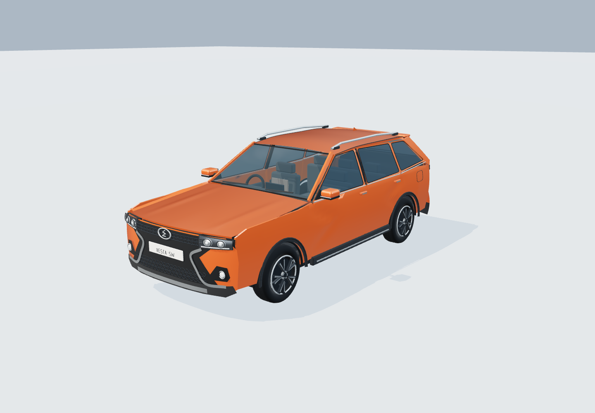
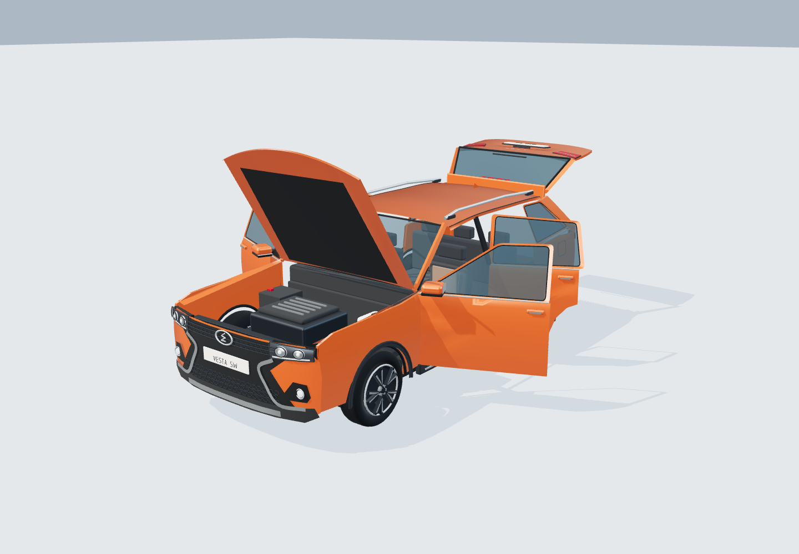

# Lada Vesta SW Cross 2019

Оригинальная стилизованная процедурная модель дорестайлингового универсала для галереи и редактора. Обводы упрощены под графику проекта; это не инженерная CAD-копия. ID в плане: `vestaSwCross2019`.

В модели четыре двери, капот с моторным отсеком, пятая дверь, салон с двумя рядами сидений, багажник, рейлинги и колёса с раздвоенными спицами. Цвет краски меняется отдельно от обвеса, стекла, шин и металла. Предусмотрены ручная степень дорожной пыли, переключение фар и плавные анимации с поддержкой уменьшения движения.

В обновлённом оформлении капот, крыша и стёкла используют сглаженные криволинейные поверхности. Боковая штамповка выполнена рельефом, вокруг окон — плоские рамки с уплотнителями. У фар отдельные отражатели, прозрачные линзы и дневные полосы; у решётки мелкие соты. Диски имеют широкие раздвоенные спицы, за которыми видны тормозные диски и суппорты. Добавлены швы сидений, дефлекторы, лючок бензобака и непрерывные штрихи шильдиков.

Размеры в сцене: 2,045 × 1,537 × 4,424 м (ширина с зеркалами, высота, длина). Масштаб фиксирован. В инвентаризации автоматически создаются два отсека — салон и багажник. Предметы и ручная заполненность управляют декоративным содержимым.

Экспорт: `web/public/models/lada-vesta-sw-cross-2019.glb`. В галерее можно скачать вариант с выбранным цветом и пылью. GLB содержит закрытый кузов, тонированные стёкла, два направленных источника света и шесть клипов `Open_frontLeft`, `Open_frontRight`, `Open_rearLeft`, `Open_rearRight`, `Open_tailgate`, `Open_hood`. Настройки инвентаризации и код управления в GLB не входят.

Проверены габариты, независимые шарниры, освобождение реальных проёмов при открытии, плавность и экспорт анимаций, направление света, сохранение цвета и отсеков. Браузерная проверка выполнена на отдельном тестовом плане.

Визуальные ориентиры: [фотография спереди](https://www.kingautos.net/169915), [фотография сзади](https://lada-xray2.ru/vse-novosti/lada-vesta-sv-kross-2019). Пропорции сверены с [буклетом LADA Vesta SW / SW Cross](https://static.lada.ru/files/brochures/models_pdf/Vesta_sw_cross-brochures.pdf). Фотографии использовались как референсы и не включены в модель или её текстуры.

